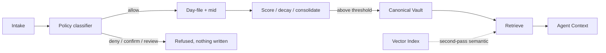

# TrustMem

Local-first memory for AI agents: distilled notes -> canonical Markdown vault
(with backlinks), with deterministic scoping and hard safety defaults.

## What it does
- Stores distilled memory logs in `memory/*.md` (no raw chat by default).
- Classifies every intake **before** anything is written: allow / deny / confirm
  / review, fail-closed, from one policy shared by the Bash CLI and Python callers.
- Assigns a stable `memory_id` at intake and carries it through scoring,
  promotion and the generated vault, so a memory can be deleted everywhere.
- Scores, decays, consolidates and promotes entries so the vault sharpens over time.
- Generates and updates a canonical vault in `vault/` (human-editable Markdown,
  backlink-friendly) with an index.
- Enforces deterministic scoping (projects / people) via `projects-map.yaml`.
- Ships safe-by-default: no shared API keys, secrets blocked, local-first defaults.

Nothing in this repository names a project, a person or a deployment. Everything
deployment-specific is configuration — see
[`docs/CANONICALIZATION.md`](docs/CANONICALIZATION.md).

## Memory Flow


## Quickstart
```bash
./scripts/install.sh
./bin/trustmem doctor
```

## Requirements
- Linux/macOS recommended. Windows: WSL2 (or Git Bash-compatible environment).
- Dependencies: `bash`, `python3`, `rg`, `awk`, `sed`, `node` (node only for the
  optional host embedding guardrail).

## Commands
```bash
./bin/trustmem --version
./bin/trustmem doctor
./bin/trustmem remember "Important preference"                # pin to vault immediately
./bin/trustmem ingest "Interaction note"                      # score only, promote later
./bin/trustmem remember --confirm "Contact test@example.com"  # explicit sensitive-content consent
./bin/trustmem forget "stale item"
./bin/trustmem recall "query text"                            # vault first, day-file fallback
./bin/trustmem sync --rebuild
./bin/trustmem learn cycle                                    # full maintenance pass
./bin/trustmem learn status                                   # learning metrics
```

## Memory Lifecycle
Every memory entry gets a stable `memory_id` assigned at intake. Entries flow
through a scoring layer before promotion to the canonical vault:
- **remember** — explicit pin, bypasses the threshold, writes to the vault immediately.
- **ingest** — records to the day-file and scores it; promoted to the vault only
  when `learn promote` runs.
- **learn cycle** — runs score, decay, consolidate, promote, prune in one pass.
- **recall** — searches the vault first, enriched with score metadata, and falls
  back to day-files.

### The day-file invariant

- **Normal lifecycle: day-files are append-only.** `remember` / `ingest` only
  append. `learn score`, `reinforce`, `decay`, `consolidate`, `promote`, `prune`
  and `cycle` **never rewrite a day-file** (asserted by
  `test_lifecycle_never_rewrites_dayfiles`).
- **Explicit `forget` is the privacy/deletion exception.** Your pattern selects day-file
  entries; everything derived from them is then removed by their **exact stable memory
  id** (never by text, so a memory with merely overlapping wording is untouched): the
  scoring table, the promotion manifest, the access log, the generated vault and its
  index, and vault backups written by earlier rebuilds. Afterwards no recoverable copy remains in TrustMem-managed current, generated and backup artifacts covered by the deletion contract
  (`test_forget_leaves_no_recoverable_copy`,
  `test_forget_is_precise_for_overlapping_memories`). Filesystem snapshots, OS or
  third-party backups, Git history and indexes built by other tools are **outside**
  that guarantee. Privacy deletion outranks literal append-only history.

`learn prune` is score-based: it removes below-threshold entries from the scoring
table, the promotion manifest and the generated vault, and never edits a day-file. A retention-based prune that
archives aged day-file content is a different operation and is not implemented
here — the distinction is deliberate and documented in
[`docs/CANONICALIZATION.md`](docs/CANONICALIZATION.md).

`forget` is the destructive path: it removes matching lines from day-files,
purges their ids from the manifests, deletes the generated notes that reference
them, and rebuilds the vault **without** leaving a backup copy of the removed
content.

## Live Learning
- **score** — assigns trust scores (0-100) to every entry, weighted by category.
- **reinforce** — boosts entries matching a pattern (manual confirmation).
- **decay** — time-based decay so stale, unreinforced entries fade. Category-aware
  retention shields important entries (decisions 365 days, preferences 10 years).
- **consolidate** — deduplicates identical entries, keeping the higher score.
- **promote** — entries above threshold become canonical vault entries.
- **prune** — removes below-threshold entries from scoring, manifest and vault.
- **cycle** — runs all of the above in one pass.

Run `trustmem learn cycle` periodically (cron, systemd timer, or after each sync)
to keep the vault sharp. The engine installs no scheduler of its own.

## Policy and Scoping

Both are configuration, and both are read at runtime.

**Policy.** The engine ships `policies/example-memory-policy.yaml`. Select a
different one with either:

```bash
export TRUSTMEM_POLICY_PROFILE=<profile>   # -> policies/<profile>-memory-policy.yaml
export POLICY_FILE=/etc/trustmem/company.yaml
```

Profiles other than the example are git-ignored, so a private profile cannot be
committed into a public fork. The classifier is fail-closed: with no readable
policy, nothing is stored.

**Scoping.** Copy `projects-map.example.yaml` to `projects-map.yaml` and describe
your projects under `projects:` and your people under `people:`. Without that
file the engine still records decisions and commitments but writes no project or
person notes — it never guesses at names it was not given.

## Security
- Never commit `.env` or any real API keys.
- Python and Bash intake use the same deterministic policy classifier before writing.
- Literal block patterns and `never_store` categories are denied and cannot be
  bypassed by confirmation.
- Sensitive content returns `confirm` and requires an explicit `--confirm`;
  ambiguous content returns `review` and is not stored.
- Callers may declare `--category raw_credentials|full_transcripts|private_personal_data`;
  every configured `never_store` category is denied.
- The classifier never prints or persists the submitted text, in either mode.
- Explicit forget and score-based prune rebuilds do not create a backup
  containing the removed content.
- Default is local embeddings for OSS; remote embeddings require BYO key.

## NVIDIA Embeddings (OpenClaw)
`nv-embedqa-e5-v5` is dual-mode:
- indexing: `nvidia/nv-embedqa-e5-v5-passage`
- querying: `nvidia/nv-embedqa-e5-v5-query`

OpenClaw single-model embedding config cannot route index vs query correctly
without provider or patch support. `trustmem doctor` warns when it finds that
combination in a host config.

## Tests
```bash
bash tests/test_trustmem.sh                     # functional suite (140 assertions)
python3 -m pytest tests/test_memory_policy.py   # classifier unit tests (52)
```
All fixtures are synthetic. CI runs both suites plus shellcheck on Ubuntu and macOS.

## Repo Layout
Tracked: templates, examples, scripts, tests, docs.
Untracked: `.env`, `projects-map.yaml`, non-example policy profiles, `memory/`,
`vault/`, `vault-backups/`.

> `examples/cursor.mcp.example.json` and `examples/claude-desktop.mcp.example.json`
> are placeholders until MCP server wiring is finalized.

## Development
### Included in this repo
- `.gitignore`, `.gitattributes`, `.env.example`
- `config.example.yaml`, `projects-map.example.yaml`, `projects/project.example.md`
- `policies/example-memory-policy.yaml`
- `examples/`
- `.github/workflows/ci.yml`
- `bin/trustmem`
- `scripts/lib.sh`, `scripts/memory_policy.py`, `scripts/doctor.sh`,
  `scripts/install.sh`, `scripts/memoryctl.sh`, `scripts/vault_sync.sh`,
  `scripts/livelearn.sh`
- `tests/test_trustmem.sh`, `tests/test_memory_policy.py`, `tests/fixtures/`
- `docs/CANONICALIZATION.md`
- `ROADMAP.md`, `LICENSE`, `SECURITY.md`, `CONTRIBUTING.md`, `CHANGELOG.md`

### Local-only (not committed)
- `.env`
- `projects-map.yaml`
- `policies/*-memory-policy.yaml` (except the example)
- `projects/*.md` (except `projects/project.example.md`)
- `memory/`, `vault/`, `vault-backups/`
